<h1 align="center">Chispa Lab</h1>

<p align="center">
  <b>El laboratorio de ciencias de una escuela que no tiene laboratorio, en el teléfono de cada niño.</b><br/>
  El niño predice, experimenta y descubre. El docente ve el avance de su clase sin internet.<br/>
  Y el sistema aprende de cada niño, dentro del teléfono.
</p>

<p align="center">
  <a href="https://danielvaldess.github.io/chispa-lab/"></a>
  <a href="https://github.com/danielvaldess/chispa-lab/releases/latest/download/chispa-lab.apk"></a>
</p>

<p align="center">
  
  
  <a href="https://github.com/danielvaldess/chispa-lab/actions/workflows/pages.yml"></a>
  
  
  
</p>

<table align="center">
<tr>
<td align="center"><a href="https://github.com/danielvaldess/chispa-lab/releases/latest/download/01-rampa.mp4">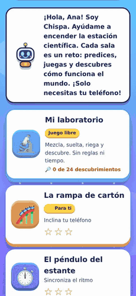</a><br/><sub><b>Predice, inclina y descubre</b></sub></td>
<td align="center"><a href="https://github.com/danielvaldess/chispa-lab/releases/latest/download/07-mi-laboratorio.mp4">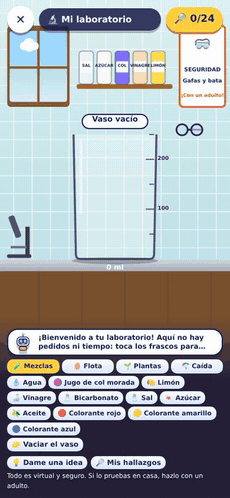</a><br/><sub><b>Mi laboratorio: mezcla y descubre</b></sub></td>
<td align="center"><a href="https://github.com/danielvaldess/chispa-lab/releases/latest/download/09-clase-qr-alumna-y-docente.mp4">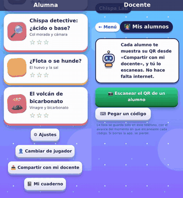</a><br/><sub><b>La clase, sin internet: QR del alumno al docente</b></sub></td>
<td align="center"><a href="https://github.com/danielvaldess/chispa-lab/releases/latest/download/10-ia-agrupa-la-clase.mp4">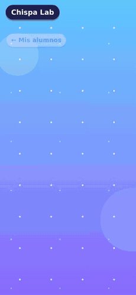</a><br/><sub><b>Chispa agrupa la clase</b></sub></td>
</tr>
</table>
<p align="center"><sub>Cada animación enlaza al vídeo completo (sin sonido, 20 a 30 s).</sub></p>

<p align="center">
  <b>6</b> juegos · <b>4</b> experimentos con materiales de casa · <b>24</b> descubrimientos · <b>7</b> apoyos de accesibilidad<br/>
  <b>6</b> técnicas de aprendizaje automático dentro del teléfono · <b>0</b> datos enviados · <b>583</b> pruebas automáticas · APK de <b>4,3 MB</b>
</p>

---

## Pruébalo en 30 segundos

| Qué | Enlace |
|---|---|
| 🌐 **Web** (se instala como app y funciona sin internet) | https://danielvaldess.github.io/chispa-lab/ |
| 📱 **App de Android (APK)**, descarga directa | [https://github.com/danielvaldess/chispa-lab/releases/latest/download/chispa-lab.apk](https://github.com/danielvaldess/chispa-lab/releases/latest/download/chispa-lab.apk) |
| 📦 Todas las versiones y archivos | https://github.com/danielvaldess/chispa-lab/releases |
| 💻 Código fuente (MIT) | https://github.com/danielvaldess/chispa-lab |
| 📊 Presentación de 5 minutos (`.pptx`) | [Chispa-Lab-hack4edu-2026.pptx](https://github.com/danielvaldess/chispa-lab/raw/main/docs/presentacion/Chispa-Lab-hack4edu-2026.pptx) |
| 📄 Artículo de investigación | [`docs/investigacion/articulo.md`](https://github.com/danielvaldess/chispa-lab/blob/main/docs/investigacion/articulo.md) |
| 🖼 Capturas de la app (`.zip`) | [capturas-chispa-lab.zip](https://github.com/danielvaldess/chispa-lab/releases/latest/download/capturas-chispa-lab.zip) |

**Android:** descarga el APK, ábrelo y permite instalar desde esa fuente (instalación directa, fuera de Google Play). Se puede pasar de un teléfono a otro por WhatsApp o Bluetooth.
**iPhone:** abre la web en Safari y usa «Compartir → Añadir a pantalla de inicio». Es la misma app.

<details>
<summary>Los 11 vídeos de la demo (sin sonido, de 20 a 30 segundos)</summary>

| Vídeo | Qué muestra |
|---|---|
| [01 · La rampa](https://github.com/danielvaldess/chispa-lab/releases/latest/download/01-rampa.mp4) | Predice, inclina el teléfono, falla y acierta |
| [02 · El péndulo](https://github.com/danielvaldess/chispa-lab/releases/latest/download/02-pendulo.mp4) | Sincroniza el ritmo con la lámpara |
| [03 · La voz y el globo](https://github.com/danielvaldess/chispa-lab/releases/latest/download/03-voz-y-globo.mp4) | Pasa los tres aros con el tono |
| [04 · El globo largo](https://github.com/danielvaldess/chispa-lab/releases/latest/download/04-globo-largo.mp4) | Sostiene la vocal para subir el globo |
| [05 · Luz y color](https://github.com/danielvaldess/chispa-lab/releases/latest/download/05-luz-y-color.mp4) | Elige los colores con las tarjetas |
| [06 · Burbujas mágicas](https://github.com/danielvaldess/chispa-lab/releases/latest/download/06-burbujas-magicas.mp4) | Revienta burbujas |
| [07 · Mi laboratorio](https://github.com/danielvaldess/chispa-lab/releases/latest/download/07-mi-laboratorio.mp4) | Mezclas, flota, plantas y caída libre |
| [08 · Registro](https://github.com/danielvaldess/chispa-lab/releases/latest/download/08-registro-estudiante-o-docente.mp4) | La pregunta «¿estudiante o docente?» y los dos recorridos |
| [09 · La clase](https://github.com/danielvaldess/chispa-lab/releases/latest/download/09-clase-qr-alumna-y-docente.mp4) | Dos teléfonos lado a lado: la alumna muestra el QR y el docente lo escanea |
| [10 · La IA agrupa la clase](https://github.com/danielvaldess/chispa-lab/releases/latest/download/10-ia-agrupa-la-clase.mp4) | El docente agrupa a sus alumnos según lo que les cuesta |
| [11 · Inclusión y apoyos](https://github.com/danielvaldess/chispa-lab/releases/latest/download/11-inclusion-apoyos.mp4) | Los siete apoyos de accesibilidad en acción |

Grabados en Chromium con tamaño de teléfono.
</details>

## Por qué importa

- **En ciencias, 6 de cada 10 estudiantes panameños de 15 años no alcanzan el nivel básico.** En PISA 2022 (OCDE) Panamá sacó **388 puntos** en ciencias; Chile, 444; Uruguay, 435; Colombia, 411; México, 410; la **Unión Europea, 480** y la **OCDE, 485**. Solo el **38 %** llega al nivel básico, frente al **76 %** en la OCDE y en la Unión Europea.
- **Nacer en una comarca indígena marca lo que se aprende.** Un niño de comarca indígena alcanza **5 años de escolaridad** y uno de zona urbana, **9** (La Prensa, 2026), y el ERCE Pospandemia 2025 asocia pertenecer a un pueblo indígena con menores aprendizajes (Ministerio de Educación de Panamá, 2025). El ERCE 2025 publicará Ciencias de 6.º a fines de 2026.
- **El laboratorio físico llega despacio.** La licitación de 2026 equipa **73 centros de media** con 193 aulas de laboratorio por **28,9 millones de dólares** (≈ 150.100 USD por aula, con equipos, instalación y capacitación). Y hay 17 clientes de internet fijo por cada 100 habitantes.
- **El teléfono ya está.** Chispa Lab convierte el que hay en el aula en un laboratorio: sin internet, sin cuentas y gratis.
- **Un lugar concreto para empezar:** la Región Educativa de Veraguas, con **54.708 estudiantes** oficiales (38.250 en primaria y premedia), donde el IPM 2025 es de 12,2 % y, en la comarca vecina Ngäbe Buglé, de 73,2 %.

Fuentes de 2024 a 2026 y su nivel de verificación: [`docs/investigacion/articulo.md`](docs/investigacion/articulo.md).

## Qué hace: tres pilares

### 1. Experimentar
El niño **predice, juega y descubre** con los sensores de su teléfono y cosas de casa. Así se cumple el ciclo que pide el reto 17: hipótesis, experimento, observación y conclusión.

| Familia | Qué se juega |
|---|---|
| 🎢 Movimiento y tiempo | La rampa de cartón (inclinación) y el péndulo del estante |
| 🎤 Sonido | La voz y el globo, y el globo largo (micrófono) |
| 🌈 Luz y cámara | Luz y color, y burbujas mágicas |
| 🧵 Experimentos con materiales de casa | Péndulo de hilo, col morada, huevo y sal, volcán de bicarbonato; cada uno se puede simular en pantalla (laboratorio híbrido) y deja su hipótesis, datos y conclusión en el **cuaderno** del niño |
| 🔬 Mi laboratorio | Juego libre sin reglas ni tiempo: mezclas, flota o se hunde, invernadero y caída libre, con 24 descubrimientos |

Detalle de cada juego y experimento: [`docs/juegos-y-experimentos.md`](docs/juegos-y-experimentos.md).

### 2. Incluir
- **Siete apoyos opcionales** («¿qué te ayuda a jugar?»): voz, oír, ver, concentrarme, leer o los números, mover las manos, y luces o ruidos que molestan. Sin pedir diagnósticos.
- **Dificultad que aprende y nunca es imposible:** parte de la edad y se ajusta a cada niño.
- Modo calma sin destellos, alto contraste, texto grande, lectura en voz alta, equivalentes visuales de cada sonido, botones grandes, pausa para descansar, y una alternativa sin sensor, sin micrófono y sin cámara en cada juego.
- Hasta 4 jugadores por teléfono. Todo se guarda **solo en el teléfono** y un adulto confirma si el jugador es menor. Chispa Lab es un juego de práctica: no es un aparato médico ni da diagnósticos.

### 3. Acompañar al docente
Al registrarse, cada persona elige si es **estudiante o docente** (no es una cuenta: solo cambia el menú).
- El alumno toca **«Compartir con mi docente»**, ve qué se comparte y muestra un **código QR** con su avance.
- El docente tiene **«Mis alumnos»**: escanea los QR uno detrás de otro y su lista queda **en su teléfono, sin internet y sin servidor**. Ve estrellas, aciertos, minutos y qué juego le cuesta a cada alumno.
- Con 4 alumnos o más, **«Agrupar mi clase»** los reparte según lo que les cuesta y sugiere qué hacer con cada grupo (ver abajo).
- No viajan la fecha de nacimiento, los apoyos, las sesiones de voz ni el cuaderno. Si el QR no se lee, el alumno envía un código de texto.
- Por qué QR y no Bluetooth, qué viaja y cómo está hecho: [`docs/clase-sincronizacion.md`](docs/clase-sincronizacion.md).

## Inteligencia artificial que aprende en el teléfono

Seis técnicas clásicas de aprendizaje automático, pequeñas, explicables y sin internet. Ningún dato sale del teléfono, y un adulto puede apagar la IA en cualquier momento.

| Técnica | Qué aprende | Dónde se ve | Cómo se midió (simulación) |
|---|---|---|---|
| **Seguimiento bayesiano del conocimiento** | Qué ideas domina cada niño | Recomienda el siguiente juego; panel de adultos | Pruebas de `test/tutor.test.js` |
| **Naïve Bayes de ideas erróneas** | Qué idea equivocada delata cada respuesta | Pistas y panel de adultos | Identifica la idea en ≈ 68 % tras 5 respuestas; ≈ 1 % de falsas alarmas (400 alumnos sintéticos por caso) |
| **Bandido de Thompson** | Si a ese niño le sirve más la pista directa o que Chispa pregunte primero | Tutor socrático | `test/ia.test.js` |
| **Centroide con pocas muestras** | Los colores que el niño le enseña (la col morada) | Chispa detective | Más del 90 % con colores y ruido sintéticos |
| **Margen bayesiano por niño** | El error típico de cada niño en la rampa y el péndulo | Ajusta el margen para acertar ≈ 7 de cada 10 veces | La brecha de acierto entre un niño que necesita 2,5 veces más margen y otro que no baja de **46 a 12 puntos**; los niños en la zona de 55 a 85 % pasan de 16 % a 42 % (300 niños por nivel de destreza) |
| **k-means++ con prueba estadística** | Qué grupos hay en la clase | «Agrupar mi clase» | **No inventa grupos** en clases parejas (99 a 100 % de 100 clases); encuentra 2 grupos reales en el 93 a 100 % y 3 en el 86 a 100 % |

Marco ético: el sistema **no evalúa, no admite ni asigna** a nadie; ajusta la práctica con supervisión humana, explica lo que hace y trabaja con datos locales, en línea con el Reglamento (UE) 2024/1689 y el marco de competencias en IA para docentes de la UNESCO (2024). Detalle, fórmulas y salvaguardas: [`docs/ia-etica.md`](docs/ia-etica.md).

## Diseñado a partir de la evidencia

| Decisión de diseño | Qué dice la evidencia (2024 a 2026) |
|---|---|
| Cada juego empieza con una **predicción** | Predecir, observar y explicar mejora el rendimiento en ciencias: g = 0,98 en un metaanálisis de 35 estudios |
| Es un **videojuego** | El aprendizaje basado en juegos digitales tiene efectos positivos en STEM de primaria (18 estudios) |
| **Mezcla lo virtual con lo real** | Los laboratorios virtuales dan g = 0,69 y funcionan mejor combinados con la práctica: por eso cada experimento se hace con materiales de casa o se simula |
| **Meta de ≈ 70 % de aciertos** | Los juegos con dificultad adaptativa mantienen a los niños en una zona de flujo de 65 a 85 % |

Referencias completas: [`docs/investigacion/articulo.md`](docs/investigacion/articulo.md), sección 11.

## Calidad y pruebas

- **583 pruebas automáticas** (`npm test`): física, señal, ajustes, perfiles, cámara, tutor, las seis técnicas de IA, la clase y el QR, que se genera y se lee de vuelta, incluso reducido a la resolución de una cámara modesta. Se ejecutan en cada publicación.
- **Pruebas de extremo a extremo en teléfonos emulados** (Chromium con perfil móvil, cámara y micrófono virtuales): navegación completa con «atrás» (`npm run probar:navegacion`) y la clase de punta a punta, con un teléfono que muestra el QR y otro que lo escanea (`npm run probar:clase`).
- **Rendimiento con la CPU limitada (Chromium con perfil móvil):** ≈ 20 a 28 fotogramas por segundo con la CPU 4 veces más lenta y ≈ 11 a 19 con 6 veces; el **modo ligero se activa solo** cuando la fluidez cae por debajo de 26 fps y sube a ≈ 22 a 28. La IA tarda ≈ 0,4 ms por partida.
- **Probada también por el autor en un teléfono**, con resultado satisfactorio.
- **Ligera:** APK de 4,3 MB; la web pesa ≈ 230 KB comprimidos y funciona sin conexión después de abrirla una vez.

Más detalle: [`docs/calidad-y-pruebas.md`](docs/calidad-y-pruebas.md).

## Impacto esperado y sostenibilidad

- **Impacto:** teoría de cambio, línea base con datos reales y escenarios de alcance en Veraguas (por ejemplo, el 5 % de la matrícula de primaria y premedia son 1.913 niños) con sus indicadores de medición: [`docs/impacto-esperado.md`](docs/impacto-esperado.md).
- **Sostenibilidad a 10 años:** código abierto sin servidor ni costo por usuario, mantenimiento con pruebas y publicación automática, convenios institucionales y hoja de ruta: [`docs/sostenibilidad-y-escalabilidad.md`](docs/sostenibilidad-y-escalabilidad.md).
- **Transferencia al mercado:** [`docs/transferencia-al-mercado.md`](docs/transferencia-al-mercado.md). **Alineación con ProFuturo:** [`docs/alineacion-profuturo.md`](docs/alineacion-profuturo.md).

## Galería

<table>
<tr><td align="center">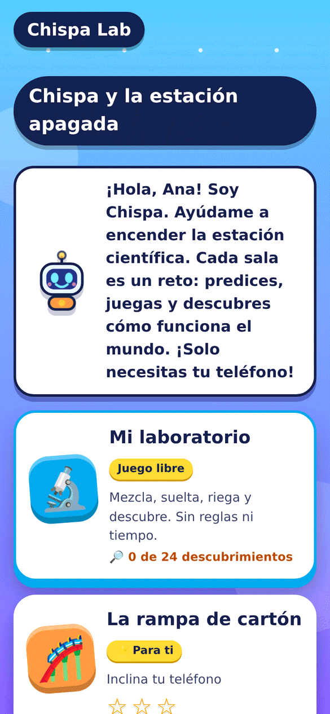<br/><sub>El menú</sub></td><td align="center">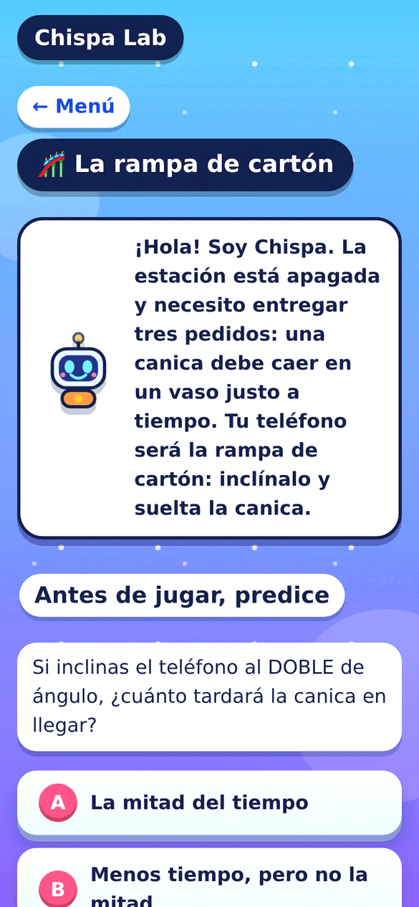<br/><sub>Predice antes de jugar</sub></td><td align="center">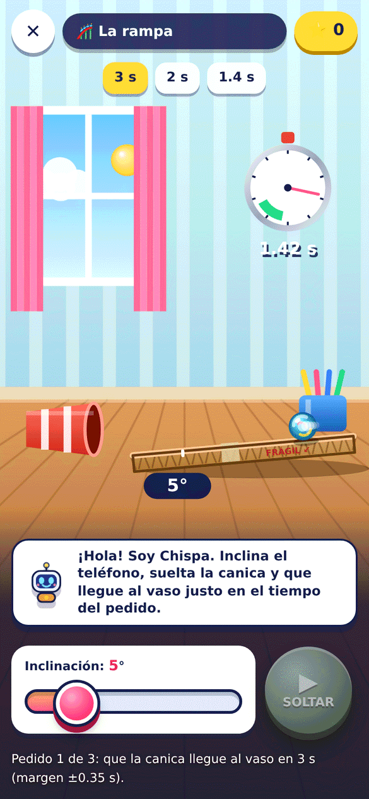<br/><sub>La rampa de cartón</sub></td><td align="center">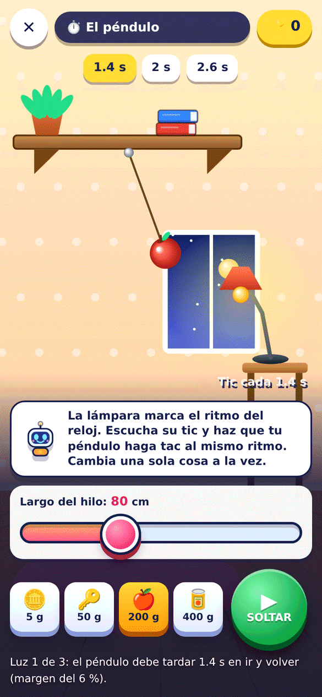<br/><sub>El péndulo del estante</sub></td><td align="center">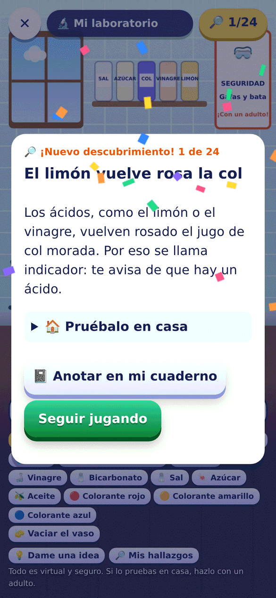<br/><sub>Un descubrimiento</sub></td></tr>
<tr><td align="center">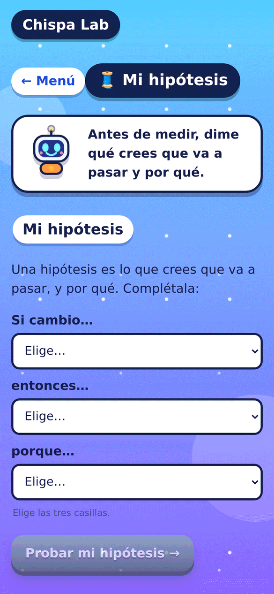<br/><sub>Mi hipótesis</sub></td><td align="center">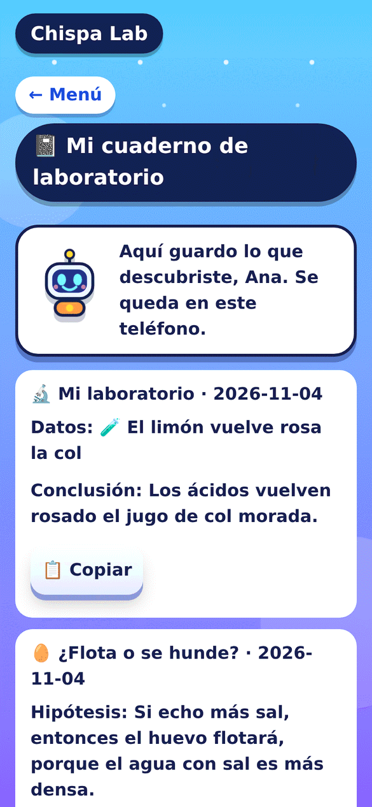<br/><sub>Su cuaderno de laboratorio</sub></td><td align="center">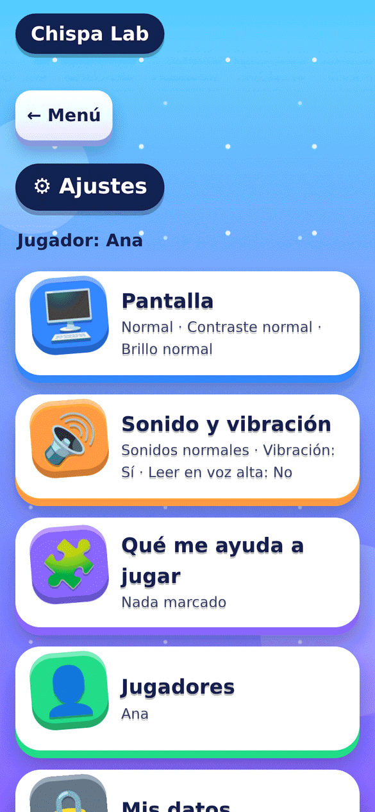<br/><sub>Ajustes y apoyos</sub></td><td align="center">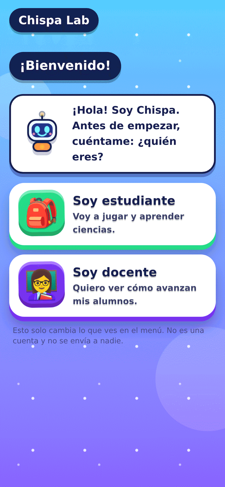<br/><sub>¿Estudiante o docente?</sub></td><td align="center">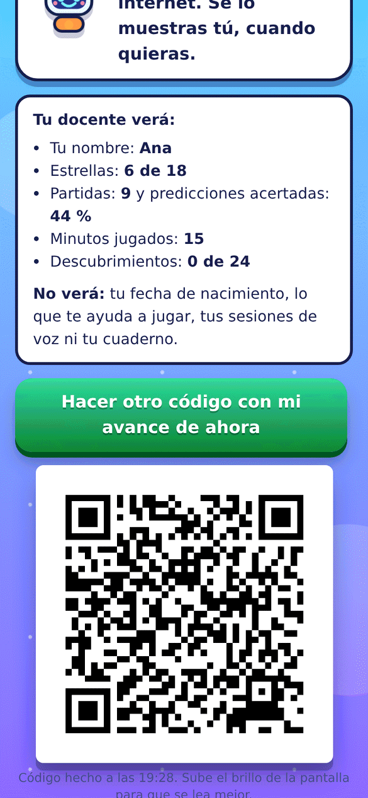<br/><sub>El alumno muestra su QR</sub></td></tr>
<tr><td align="center">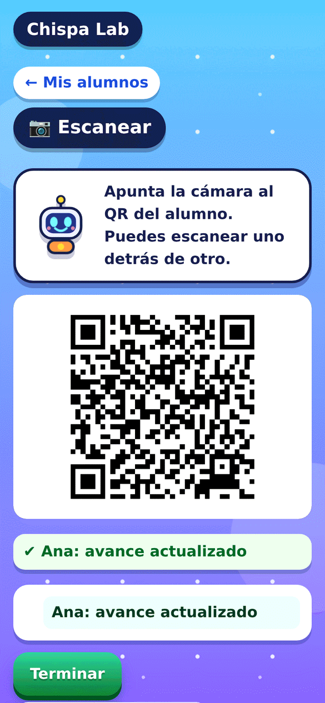<br/><sub>El docente lo escanea</sub></td><td align="center">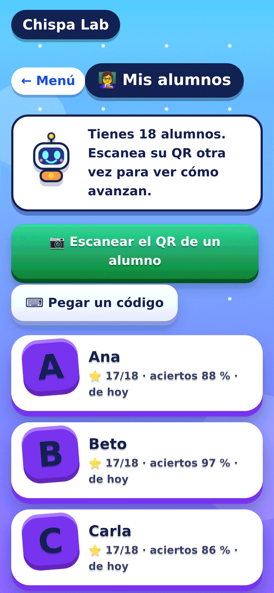<br/><sub>Su lista de alumnos</sub></td><td align="center">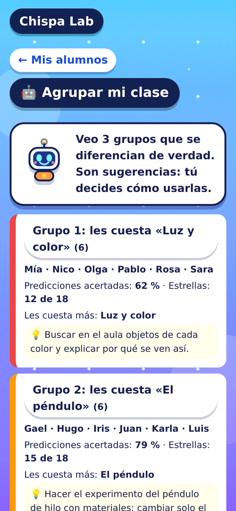<br/><sub>Agrupar mi clase</sub></td><td align="center">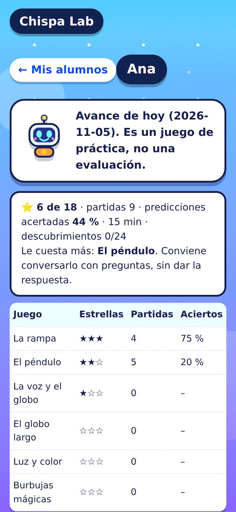<br/><sub>Detalle de un alumno</sub></td><td align="center">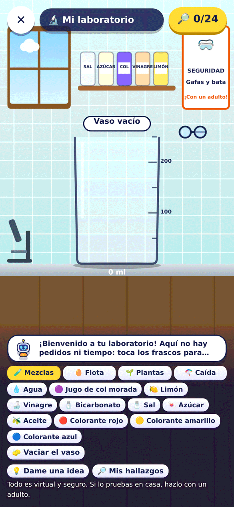<br/><sub>Mi laboratorio</sub></td></tr>
</table>

## Ejecutar

Requiere Node 20 o superior (solo para el servidor estático y las pruebas).

```bash
npm start                    # http://localhost:8080
npm test                     # 583 pruebas
npm run probar:navegacion    # recorre todas las pantallas en un teléfono emulado
npm run probar:clase         # alumno muestra el QR, docente lo escanea
```

La web se publica sola en GitHub Pages en cada cambio de `main` (el flujo corre las pruebas primero).

### App de Android

La misma web se empaqueta como app nativa con [Capacitor](https://capacitorjs.com) (Android 6.0 o superior). Requiere JDK 21 y el SDK de Android (`ANDROID_HOME`):

```bash
npm install
npm run android   # genera android/app/build/outputs/apk/debug/app-debug.apk
```

El juego está pensado para el móvil en vertical; en el ordenador, abre las herramientas de desarrollo y activa la vista de dispositivo.

## Documentación

[Juegos y experimentos](docs/juegos-y-experimentos.md) · [IA y ética](docs/ia-etica.md) · [Clase y QR](docs/clase-sincronizacion.md) · [Impacto esperado](docs/impacto-esperado.md) · [Sostenibilidad y escalabilidad](docs/sostenibilidad-y-escalabilidad.md) · [Calidad y pruebas](docs/calidad-y-pruebas.md) · [Transferencia al mercado](docs/transferencia-al-mercado.md) · [Alineación con ProFuturo](docs/alineacion-profuturo.md) · [Impacto y ética (datos y privacidad)](docs/impacto-y-etica.md) · [Guía docente](docs/guia-docente.md) · [Presentación y vídeo](docs/presentacion/) · [Bitácora del hackatón](docs/evidencia-desarrollo.md)

## Estructura

```
index.html            el videojuego
css/                  estilos
js/juego.js           menú, rutas, niveles, puntos y resultados
js/dsp.js             procesamiento de señal (tono YIN, filtros)
js/fisica.js          fórmulas de la rampa, el péndulo y la caída libre
js/tutor.js           seguimiento bayesiano del conocimiento
js/diagnostico.js     naïve Bayes de ideas erróneas
js/bandido.js         bandido de Thompson
js/pistas.js          pregunta, pista y explicación con los datos del niño
js/color-ml.js        centroide con pocas muestras (colores de la col)
js/margen.js          margen bayesiano que aprende cada niño
js/agrupar.js         k-means++ con prueba estadística (grupos de la clase)
js/clase.js           código del alumno, lectura, fusión de alumnos y resúmenes
js/alumnos.js         pantallas de la clase: QR, «Mis alumnos», escáner y grupos
js/vendor/            dos librerías pequeñas solo para el QR (MIT y Apache-2.0)
js/perfiles.js        perfiles locales, apoyos y datos; js/perfil.js, js/panel.js: pantallas
js/libre.js, mezclas.js, densidad.js, planta.js, descubrimientos.js   Mi laboratorio
js/metodo.js, experimento.js, niveles/   hipótesis, cuaderno y experimentos con materiales
sw.js                 modo sin conexión
android/              proyecto nativo de Capacitor
scripts/              servidor, empaquetado, mediciones y pruebas de extremo a extremo
test/                 pruebas automáticas
docs/                 documentación, capturas (`capturas/`) y animaciones (`media/`)
```

## Alcance y siguientes pasos

Chispa Lab está listo para llevarse al aula. Esto es lo que sigue:

- **Piloto en la Región Educativa de Veraguas** con la UTP, ProFuturo y el Meduca: es el paso que mide el aprendizaje con estudiantes y docentes (indicadores en [`docs/impacto-esperado.md`](docs/impacto-esperado.md)).
- **Calibrar la IA con los datos del piloto:** hoy los modelos parten de valores de la literatura y sus cifras de evaluación son de simulación.
- **Medir en teléfonos de gama baja** la fluidez, el calor y la batería (las cifras actuales son de Chromium con la CPU limitada).
- **Idiomas:** español hoy; inglés y portugués, idiomas oficiales de hack4edu y de ProFuturo, son el siguiente paso.
- **Clase:** copia de respaldo de la lista del docente y sincronización entre dos teléfonos del mismo docente.
- **Comparar con Ciencias de 6.º** cuando se publique el ERCE 2025 (fines de 2026).

## Licencia

Código bajo licencia [MIT](LICENSE). Documentación y recursos (`docs/`) bajo [CC BY-NC-SA 3.0](docs/LICENCIA.md).
