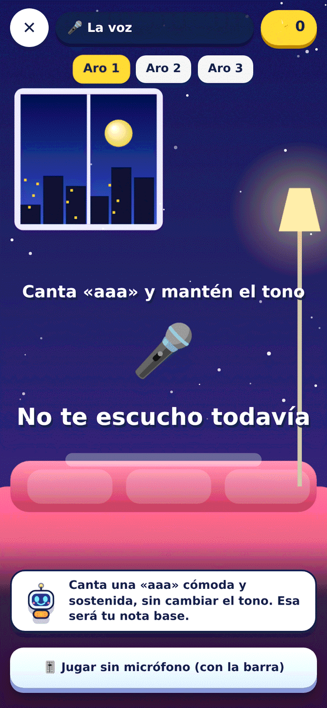
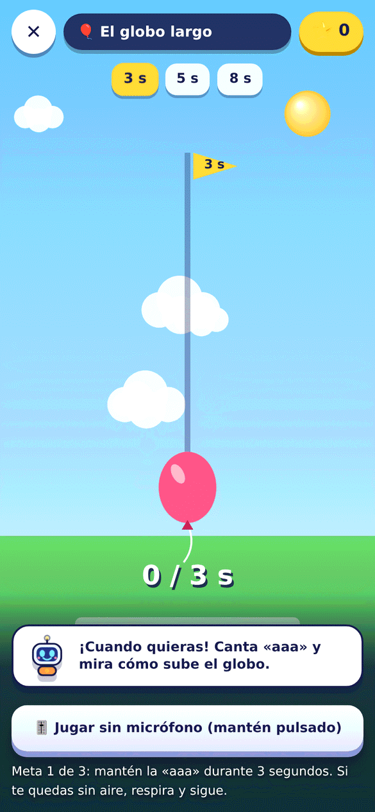
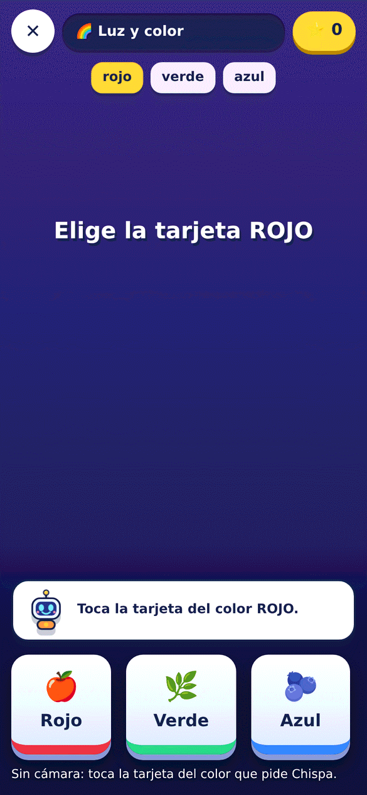
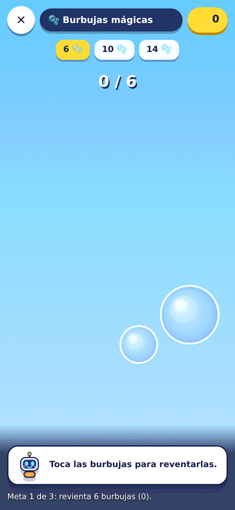
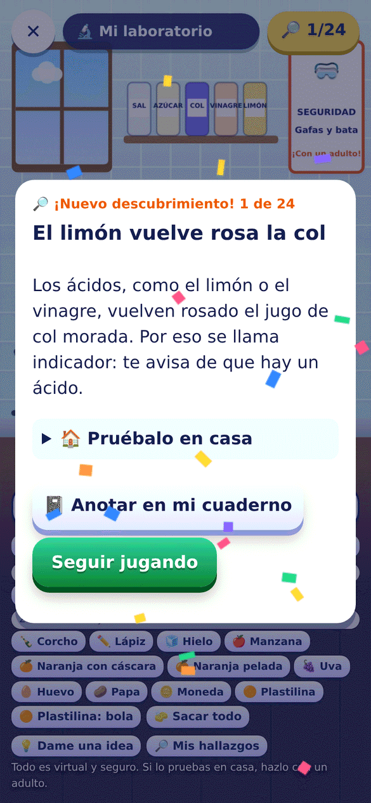
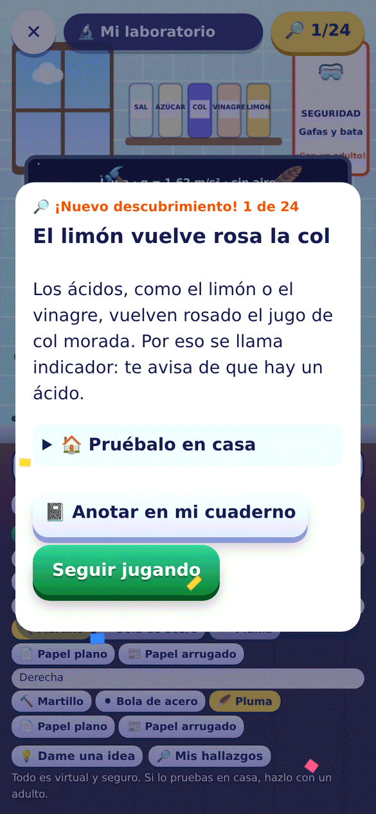
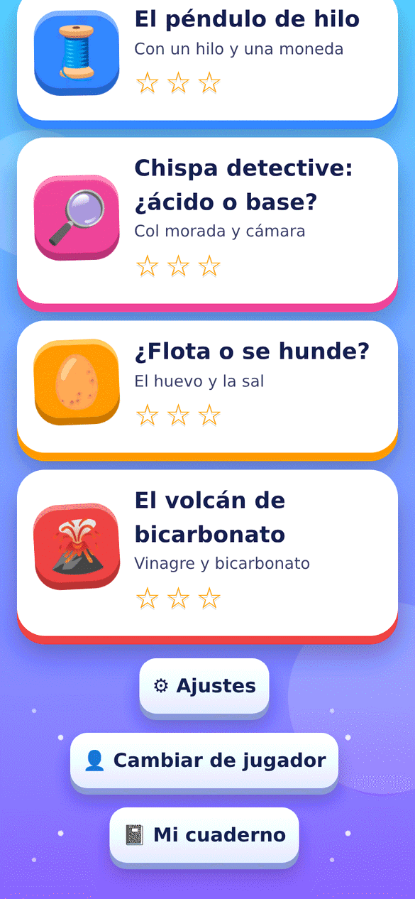
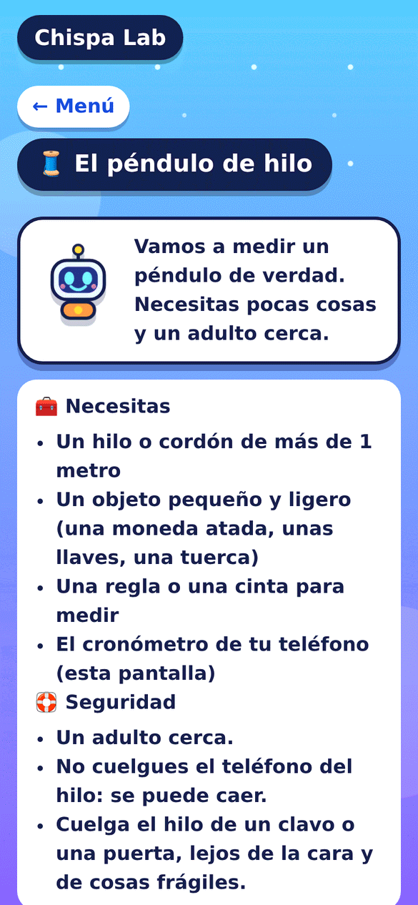

<h1 align="center">Chispa Lab</h1>

<p align="center">
  <b>Un laboratorio de ciencias donde no existe un laboratorio.</b><br/>
  Videojuego educativo para el teléfono: el estudiante predice, juega y descubre,
  con objetos de casa y los sensores de su propio móvil.
</p>

<p align="center">
  
  
  
  
  
</p>

---

## ¿Qué es?

**Reto 17 de #hack4edu 2026 (sede UTP Veraguas).** Muchas escuelas no tienen laboratorio.
Chispa Lab convierte el teléfono y los objetos cotidianos (una rampa de cartón, una moneda colgada de un
hilo, tu propia voz) en un laboratorio de física que se juega. En la historia, **Chispa** necesita ayuda para
encender la estación científica: cada sala es un nivel.

Cada nivel sigue el ciclo del método científico: **predices**, **juegas** y **descubres** qué pasó con tus
propios datos.

## Capturas

Capturas reales de la app (Chromium con tamaño de teléfono, 390×844; en Luz y color y Burbujas se usó la opción «sin cámara»). Todas están en [`docs/capturas/`](docs/capturas/).

<table>
<tr><td align="center"><br/><sub>Menú con Chispa y Mi laboratorio</sub></td><td align="center"><br/><sub>Predice antes de jugar</sub></td><td align="center"><br/><sub>La rampa de cartón</sub></td><td align="center"><br/><sub>El péndulo del estante</sub></td></tr>
<tr><td align="center"><br/><sub>La voz y el globo</sub></td><td align="center"><br/><sub>El globo largo</sub></td><td align="center"><br/><sub>Luz y color</sub></td><td align="center"><br/><sub>Burbujas mágicas</sub></td></tr>
<tr><td align="center"><br/><sub>Mi laboratorio: mezclas</sub></td><td align="center"><br/><sub>Un descubrimiento</sub></td><td align="center"><br/><sub>Flota o se hunde</sub></td><td align="center"><br/><sub>Caída libre</sub></td></tr>
<tr><td align="center"><br/><sub>Experimentos con materiales</sub></td><td align="center"><br/><sub>Materiales de casa y seguridad</sub></td><td align="center"><br/><sub>Mi hipótesis</sub></td><td align="center"><br/><sub>Ajustes y apoyos</sub></td></tr>
</table>

## Los niveles

| Nivel | Qué se aprende | Cómo se juega |
|---|---|---|
| 🎢 **La rampa de cartón** | Al doblar el ángulo, la canica tarda menos, pero no la mitad | Inclina el teléfono (o la barra) y suelta la canica para que llegue al vaso en 3, 2 y 1,4 s |
| ⏱ **El péndulo del estante** | El periodo depende del largo del hilo, no de la masa | Iguala el ritmo de la lámpara cambiando el largo del hilo con una moneda, unas llaves, una manzana o una lata |
| 🎤 **La voz y el globo** | Más agudo = más vibraciones por segundo | Canta una nota base y súbela para pasar el globo por tres aros (con micrófono o con barra) |
| 🎈 **El globo largo** | Una vocal sostenida mantiene un tono casi plano | Canta «aaa» sin prisa y el globo sube mientras suenas; práctica de voz con un registro de sesiones para llevar al especialista |
| 🌈 **Luz y color** | Un objeto se ve de un color porque devuelve esa luz; las sombras tapan la luz | La cámara busca algo rojo, verde y azul, y una sombra de media imagen (o tarjetas si no hay cámara) |
| 🫧 **Burbujas mágicas** | Una cámara detecta movimiento comparando fotos seguidas | Ves la cámara y revientas burbujas moviendo la mano (o tocándolas) |

Cada pedido da puntos según la precisión, con **combo**. Cada nivel da hasta 3 estrellas y, al final, una pregunta con tus datos y una
explicación de qué pasó. 

## Por qué importa

Muchas escuelas no tienen laboratorio. Chispa Lab lleva la experimentación a cualquier salón con un teléfono, sin internet, sin cuentas y gratis.
Es un videojuego que enseña a **formular una hipótesis, probarla y comparar con los datos propios**, y que se adapta a cada niño. Cómo encaja con
la misión de ProFuturo y con el reto 17, con sus brechas y límites dichos con claridad, está en
[`docs/alineacion-profuturo.md`](docs/alineacion-profuturo.md).

## Mi laboratorio (juego libre)

Para jugar sin que nadie diga qué hacer, el menú tiene **«🔬 Mi laboratorio»**: un laboratorio dibujado como uno de verdad (ventana, estante con frascos rotulados, póster de seguridad,
mesa con vaso de precipitados graduado, microscopio y gafas). No hay pedidos, puntos ni tiempo, y no se puede fallar. Todo es virtual y de cocina, así que **no hay riesgo**; cada hallazgo dice cómo probarlo en casa con un adulto.

| Estación | Qué se puede probar |
|---|---|
| 🧪 **Mesa de mezclas** (química) | Echar agua, jugo de col, limón, vinagre, bicarbonato, sal, azúcar, aceite y colorantes. Ver el color del indicador, las burbujas de ácido + bicarbonato, las capas del aceite, la sal que se disuelve y se satura, y los colores que salen al mezclar los tres colorantes |
| 🥚 **Flota o se hunde** (física y química) | Una torre de líquidos (aceite, agua, agua con sal, miel) y 11 objetos: el huevo que flota con sal, la naranja con y sin cáscara y la plastilina en bola o en barquito |
| 🌱 **Invernadero** (biología y matemáticas) | Cuatro semillas de frijol con agua y luz distintas; dejar pasar los días y ver la gráfica de alturas |
| 🪂 **Caída libre** (física) | Martillo, pluma, bola o papel, en la Tierra, la Luna o Marte, con o sin aire |

Hay **24 descubrimientos** que aparecen solos al probar cosas, y el niño decide si los anota en su cuaderno. «💡 Dame una idea» sugiere una pregunta sin dar la respuesta. El invernadero y las densidades son **modelos
simplificados y cualitativos** (la pantalla lo dice), pensados para jugar, no para medir. El panel para adultos muestra cuántos descubrimientos lleva cada niño.

## Experimentos con materiales

Además de los seis juegos, el menú tiene una sección **opcional** de experimentos de verdad, con cosas de casa. No hacen falta para encender la estación ni cuentan para los finales,
y cada uno se puede **simular en la pantalla** si no hay materiales (un laboratorio *híbrido*: virtual o real). Todos siguen el ciclo científico: predicción, **hipótesis**
(«Si cambio ___, entonces ___ porque ___»), prueba justa, datos, conclusión y un **cuaderno de laboratorio** que queda en el teléfono.

| Experimento | Materiales | Qué se aprende |
|---|---|---|
| 🧵 **El péndulo de hilo** | Hilo, un objeto pequeño y el cronómetro del teléfono | El tiempo depende del largo del hilo (no del peso) y crece como su raíz; gráfica de T² contra el largo y estimación de la gravedad |
| 🥚 **¿Flota o se hunde?** | Un vaso de agua, sal y un huevo (o una uva) | El clásico del huevo y la sal: cambia solo la sal y anota si flota; el agua con sal es más densa |
| 🌋 **El volcán de bicarbonato** | Bicarbonato, vinagre, un vaso abierto y una bandeja | Con la misma cantidad de bicarbonato y más y más vinagre, mide cuánto burbujea y descubre que hay un tope (reactivo limitante) |
| 🔎 **Chispa detective: ¿ácido o base?** | Jugo de col morada, vasos, limón, bicarbonato, vinagre y la cámara | La col es un indicador: el niño le **enseña** a Chispa tres vasos y ella reconoce los vasos misteriosos por su color (aprendizaje con pocas muestras en el teléfono) |

Cada experimento abre con una tarjeta de seguridad (adulto cerca, solo cosas de cocina, no probar ni oler, no mezclar productos de limpieza). Chispa **no mide el pH**: dice a cuál de los
vasos que le enseñaron se parece, y si no está segura lo dice.

## Finales y recompensas

La historia es **encender la estación científica**, y tiene tres finales según las estrellas (la menor cantidad entre los seis juegos):

| Estrellas en cada juego | Qué pasa |
|---|---|
| 1 | **La estación se enciende:** las seis salas se iluminan una a una y Chispa cuenta lo que el jugador descubrió |
| 2 | **A toda potencia:** final mejorado con fuegos artificiales y un **diploma** con su nombre, que se puede guardar como imagen |
| 3 | **La estación de las estrellas:** **Chispa se pone la bata y las gafas de científico** en todo el juego y la estación se vuelve dorada |

Las recompensas son **cosméticas**: nada necesario para jugar queda bloqueado, y con el modo calma no hay fuegos artificiales ni confeti. El final básico solo exige
completar los juegos; con 2 estrellas basta con predecir bien (no depende de la destreza), y con el apoyo de voz la tercera estrella de los juegos de voz no
penaliza el tiempo ni la estabilidad del tono.

## Investigación y presentación

- **Artículo de investigación** con datos de Panamá y de la Región Educativa de Veraguas, evidencia de la literatura, mediciones técnicas propias y ODS. **Todas las fuentes son de 2024 a 2026**, cada una con su nivel de verificación, y lo que no tiene dato reciente se dice: [`docs/investigacion/articulo.md`](docs/investigacion/articulo.md).
- **Presentación de 5 minutos** (11 diapositivas, con notas y guion): [`docs/presentacion/`](docs/presentacion/).
- **Transferencia al mercado:** [`docs/transferencia-al-mercado.md`](docs/transferencia-al-mercado.md).

## IA ligera y ética

Chispa incluye una **IA ligera de tres piezas** que corre **en el teléfono, sin internet y sin enviar datos** (unos 31 KB de código, casi todo plantillas de texto, sin librerías):

- **Tutor bayesiano:** estima qué ideas domina cada niño y recomienda el siguiente juego.
- **Diagnóstico de ideas erróneas:** cada respuesta equivocada delata una idea concreta («si doblo el ángulo, el tiempo baja a la mitad») y se calcula su probabilidad con la regla de Bayes.
- **Tutor socrático:** al terminar cada juego, Chispa hace una pregunta, da una pista y explica **con los números que midió el propio niño**; un bandido de Thompson aprende si a ese
  niño le sirve más la pista de una vez o que Chispa pregunte primero.

No es IA generativa: las frases son plantillas con huecos, no inventan texto. Un adulto puede apagarla («IA de Chispa: Sí/No») o reiniciarla, y no penaliza las dificultades motrices o de voz.
En una **simulación** (no un piloto) el diagnóstico identifica la idea errónea en ≈ 68 % de los casos tras 5 respuestas y señala a ≈ 1 % de quienes sí entienden. Detalle, fórmulas, costo medido y límites en [`docs/ia-etica.md`](docs/ia-etica.md);
cómo puede sostenerse en [`docs/transferencia-al-mercado.md`](docs/transferencia-al-mercado.md).

## Jugadores y apoyos

Al abrir la app por primera vez, un asistente de una pantalla por paso pide el **nombre o apodo**, el **mes y año de nacimiento** y «**¿qué te
ayuda a jugar?**» (casillas opcionales: voz, oír, ver, concentrarme, leer o los números, mover las manos, luces o ruidos que molestan). Con eso:

- **Edad:** más margen para acertar a los más pequeños y retos más exactos a los mayores. La dificultad se ajusta sola durante la partida y
  **nunca se vuelve imposible**.
- **Apoyos:** modo calma, alto contraste, texto grande y lectura en voz alta, equivalentes visuales de los sonidos, botones grandes con «+» y «−»,
  pausa para descansar y más facilidades en los juegos de voz.
- Hasta **4 jugadores** por teléfono, con su progreso por separado. Sirve en la web, en el iPhone (instalada desde Safari) y en el APK.
- Todo se guarda **solo en el teléfono** y se borra desde Ajustes. Un adulto debe confirmar si el jugador es menor de 18 años y elige algún apoyo.
  Detalle y límites en [`docs/impacto-y-etica.md`](docs/impacto-y-etica.md). Chispa Lab **no es un aparato médico ni da diagnósticos**.
- **Voz de Chispa:** al «Leer en voz alta», elige entre las voces en español del propio teléfono una voz **femenina, cálida y que funcione sin internet** (tono apenas más alto que lo normal, sin chillar, y ritmo tranquilo); el botón «🔁 Otra voz» prueba otra y la recuerda. Depende de las voces que tenga el teléfono.
- **Ajustes con secciones** (Pantalla, Sonido y vibración, Qué me ayuda a jugar, Jugadores, Mis datos) y un panel **«Para adultos y docentes»** con el
  resumen de aprendizaje de cada jugador y una guía breve para el aula.

## Cómo funciona

- **Física real:** las escenas usan las fórmulas del fenómeno, en [`js/fisica.js`](js/fisica.js), y el
  tono se detecta con el método YIN en [`js/dsp.js`](js/dsp.js). El audio no se graba ni sale del teléfono.
- **Sin conexión:** es una PWA; un service worker guarda los archivos y el juego funciona sin internet.
- **Sin dependencias:** HTML, CSS y JavaScript puros (ES5, para celulares viejos). Las escenas se dibujan en
  canvas 2D con degradados y sombras para dar volumen sin motores 3D. La cámara y el micrófono se procesan en el teléfono y no se guardan.
- **Privacidad:** sin cuentas ni servidor. Nombre, mes y año de nacimiento, apoyos y progreso viven solo en el dispositivo; no se envía nada.
- **Accesibilidad:** respeta `prefers-reduced-motion`, baja las partículas en móviles de pocos núcleos y cada
  nivel tiene alternativa sin sensor (barra) y sin micrófono.

## Probarlo ahora

- **Web (se instala como app y funciona sin internet):** https://danielvaldess.github.io/chispa-lab/
- **App de Android (APK):** https://github.com/danielvaldess/chispa-lab/releases/latest

## Ejecutar

Requiere Node 20 o superior (solo para el servidor estático y las pruebas).

```bash
npm start        # http://localhost:8080
npm test         # señal, física, ajustes, perfiles, cámara, tutor y textos
```

### App de Android

La misma web se empaqueta como app nativa con [Capacitor](https://capacitorjs.com) (Android 6.0 o superior).
Requiere JDK 21 y el SDK de Android (`ANDROID_HOME`):

```bash
npm install
npm run android   # genera android/app/build/outputs/apk/debug/app-debug.apk
```

El APK de la última versión está en [Releases](../../releases). En el iPhone, el juego se instala desde
Safari con «Añadir a pantalla de inicio».

El juego está pensado para el móvil en vertical; en el ordenador, abre las herramientas de
desarrollo y activa la vista de dispositivo.

## Estructura

```
index.html          el videojuego
lab.html            herramienta de medición con sensores (sin enlace desde el juego)
sensores.html       prueba de sensores (sin enlace desde el juego)
css/                style.css · juego.css
js/juego.js         menú, niveles, puntos y resultados
js/lab.js           medición con sensores
js/dsp.js           procesamiento de señal (tono YIN, filtros)
js/tutor.js         tutor bayesiano (dominio de cada idea)
js/libre.js         escena de Mi laboratorio (juego libre)
js/mezclas.js       motor de la mesa de mezclas (puro)
js/densidad.js      motor de flota o se hunde (puro)
js/planta.js        modelo cualitativo del invernadero (puro)
js/descubrimientos.js  catálogo de 24 descubrimientos y sugerencias
js/metodo.js        hipótesis, prueba justa, estadística y cuaderno de laboratorio
js/color-ml.js      aprendizaje de colores con pocas muestras (centroide más cercano)
js/experimento.js   pantallas comunes de los experimentos con materiales
js/niveles/hilo.js  experimento del péndulo de hilo
js/niveles/col.js   experimento ácido/base con col morada
js/niveles/huevo.js experimento del huevo y la sal
js/niveles/volcan.js experimento del volcán de bicarbonato
js/diagnostico.js   diagnóstico de ideas erróneas
js/pistas.js        pregunta, pista y explicación con los datos del jugador
js/bandido.js       aprendizaje por niño (bandido de Thompson)
js/fisica.js        fórmulas de la rampa y el péndulo
sw.js               modo sin conexión
android/            proyecto nativo de Capacitor
scripts/            servidor estático y empaquetado
test/               pruebas
```

## Bajo coste y conectividad limitada

| Qué | Valor (medido en un ordenador) |
|---|---|
| APK de Android | ≈ 4,2 MB; Android 6.0 o más |
| Primera carga de la web | ≈ 155 KB comprimidos (411 KB sin comprimir, con los iconos) y ninguna librería externa |
| Internet | No hace falta después de abrirla una vez; sin cuentas ni servidores |
| Costo de la IA | ≈ 0,4 ms por partida con la CPU 6 veces más lenta (Chromium); solo corre al terminar un juego |
| Materiales | Teléfono; los experimentos usan cosas de casa o se simulan en pantalla |

Para docentes: [`docs/guia-docente.md`](docs/guia-docente.md). Cómo probarlo en un teléfono: [`docs/prueba-telefono.md`](docs/prueba-telefono.md).

## Estado

- **Hecho:** seis juegos, cuatro experimentos con materiales, un laboratorio libre con 24 descubrimientos, perfiles con apoyos, IA ligera, panel para adultos, finales, PWA sin conexión y APK de Android. `npm test` ejecuta 469 comprobaciones.
- **Probado:** en Chromium de escritorio (tamaño de teléfono, CPU frenada, micrófono y cámara simulados) y con pruebas automáticas. El APK se compila y se instala en el emulador, pero **el emulador de WSL se cierra
  al abrir cualquier app con WebView, así que no se recorrió un nivel en Android**.
- **Sin probar:** en un teléfono real (sensor de inclinación, micrófono, cámara, vibración, voz sintetizada, calor y batería), con niños, con un docente y con col morada real. La simulación de la IA **no es un piloto**.
- Las bandas de dificultad por edad y los parámetros de la IA son valores por defecto sin calibrar.

## Origen y evidencia de desarrollo

Chispa Lab parte de un **prototipo previo** (tres juegos, detector de tono, física y PWA, hecho el 29–30 de octubre) que se incorporó a este repositorio el 4 de noviembre con la autorización de la
organización del hackatón, según declara el autor. Hoy ≈ 42 % de las líneas de JavaScript, CSS y HTML vienen de esa importación y ≈ 58 % se escribió aquí: perfiles y apoyos,
tres juegos nuevos, la IA ligera, el método científico y los experimentos con materiales. No hay commits del 3 de noviembre y las fechas son las reales.
Detalle, números y cómo comprobarlos en [`docs/evidencia-desarrollo.md`](docs/evidencia-desarrollo.md).

## Licencia

Código bajo licencia [MIT](LICENSE). Documentación y recursos (`docs/`) bajo [CC BY-NC-SA 3.0](docs/LICENCIA.md).
